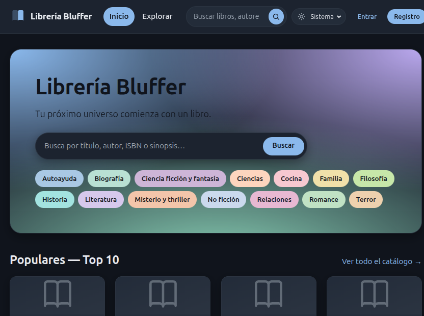
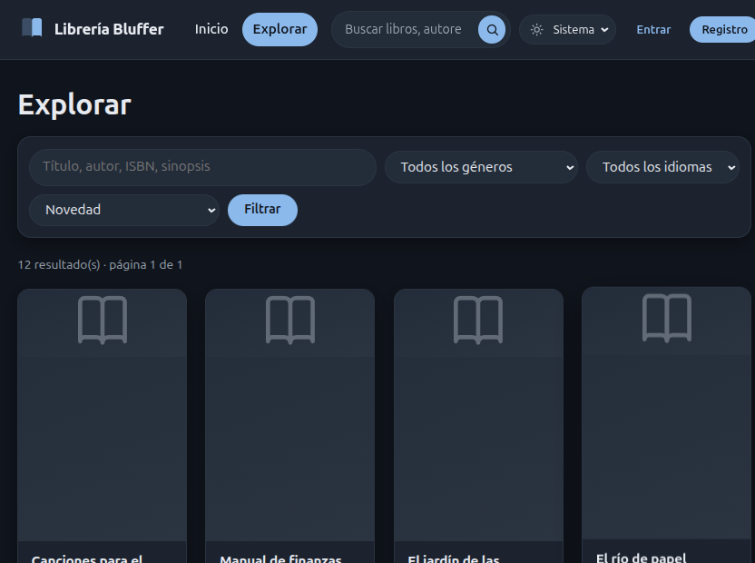
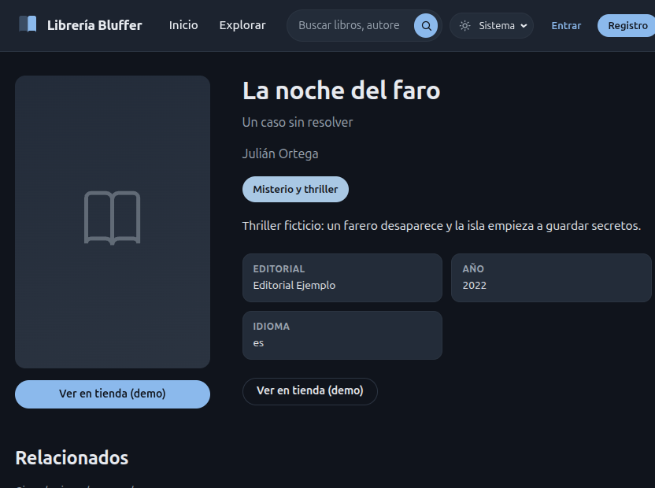

# Librería Nexus (Bluffer)

Proyecto demostrativo de una librería digital de afiliados, hecho con Flask y SQLite.
El usuario explora un catálogo de libros, guarda favoritos y organiza su biblioteca personal.
Al hacer clic en un libro se llega al enlace externo de compra (afiliado).

> **Aviso:** los datos de demo son ficticios y la app es una idea demostrativa.
> No hay tienda real ni pagos, y los enlaces de la demo apuntan a `example.com`.

## Capturas

> Capturas tomadas con los **datos de demo ficticios** (`scripts/seed_demo.py`).
> Son solo datos e idea demostrativa, no un catálogo ni una tienda real.

| Inicio | Explorar | Ficha de libro |
|--------|----------|----------------|
|  |  |  |

## Funcionalidades

- **Catálogo** con búsqueda, filtros por género e idioma, orden (novedad, título, año) y paginación.
- **Ficha de libro** con sinopsis, autores, editorial y enlace externo.
- **Cuentas de usuario**: registro, login y perfil, con contraseñas hasheadas y límite de intentos de login.
- **Favoritos** y **biblioteca personal** con estado de lectura (pendiente, leyendo, terminado) y progreso.
- **Panel de administración**: alta y edición de libros, autores, editoriales y géneros.

## Stack

- **Backend:** Python 3.12, Flask 3
- **Base de datos:** SQLite, con esquema versionado y migraciones simples en `migrations/`
- **Frontend:** plantillas Jinja2 y CSS propio, sin frameworks de JavaScript

## Arquitectura en capas

```
Navegador
   │
   ▼
Rutas (Blueprints)        nexus/catalog.py · auth.py · library.py · admin.py · store.py · reader.py
   │
   ▼
Acceso a datos            nexus/database.py  (conexión, esquema, migraciones)
   │
   ▼
SQLite                    instance/libreria.db  (fuera del repositorio)
```

- **Presentación:** `nexus/templates/` (Jinja2) y `static/` (CSS, portadas).
- **Aplicación:** cada módulo de `nexus/` agrupa una funcionalidad como Blueprint de Flask.
- **Datos:** `nexus/schema.sql` define las tablas; `database.py` aplica el esquema y las migraciones.
- **Configuración:** `config.py` lee variables de entorno (`SECRET_KEY`, `DATABASE_PATH`, `BOOKS_DIR`).
- **Scripts:** `scripts/create_admin.py` crea un administrador y `scripts/seed_demo.py` carga la demo.

## Puesta en marcha (local)

Requisitos: Python 3.12 o superior.

```bash
git clone <url-del-repo>
cd 999libreriadigital

python -m venv .venv
source .venv/bin/activate        # En Windows: .venv\Scripts\activate
pip install -r requirements.txt
```

Las variables de entorno se pasan al ejecutar (ver [Configuración](#configuración)). `.env.example` muestra los valores posibles.

### Cargar la demo

Usa una base separada para no mezclar la demo con datos propios:

```bash
DATABASE_PATH=instance/demo.db python scripts/seed_demo.py
```

Esto crea 12 libros ficticios, autores y editoriales inventados, y dos usuarios de prueba:

| Rol     | Usuario      | Contraseña     |
|---------|--------------|----------------|
| Usuario | `demo`       | `demo123456`   |
| Admin   | `admin_demo` | `admin123456`  |

Estas credenciales son públicas y solo sirven para la demo local.

### Ejecutar

```bash
DATABASE_PATH=instance/demo.db python app.py
```

Abre <http://127.0.0.1:5000>.

Para tu propia base, crea un administrador con:

```bash
python scripts/create_admin.py USUARIO CONTRASEÑA [EMAIL]
```

## Configuración

| Variable                 | Por defecto                 | Uso                                              |
|--------------------------|-----------------------------|--------------------------------------------------|
| `SECRET_KEY`             | `dev-only-change-me`        | Firma de sesiones. Cámbiala fuera de local.      |
| `DATABASE_PATH`          | `instance/libreria.db`      | Ruta de la base SQLite.                          |
| `BOOKS_DIR`              | `protected_books/`          | Carpeta de archivos de libros (no versionada).   |
| `SESSION_COOKIE_SECURE`  | `0`                         | Poner `1` solo si se sirve por HTTPS.            |

## Estructura

```
app.py                  Punto de entrada
config.py               Configuración por variables de entorno
nexus/                  Paquete de la aplicación (blueprints, base de datos, esquema)
nexus/templates/        Plantillas Jinja2
migrations/             Migraciones SQL versionadas
scripts/                Administrador inicial y datos de demo
static/                 CSS y portadas
roadmap/                Hoja de ruta y notas de despliegue
tests/                  Pruebas (pendiente)
```

## Estado

Versión offline: catálogo, favoritos, biblioteca, administración y datos de demo.
Pendientes técnicos y de publicación están en [`roadmap/ROADMAP.md`](roadmap/ROADMAP.md).
